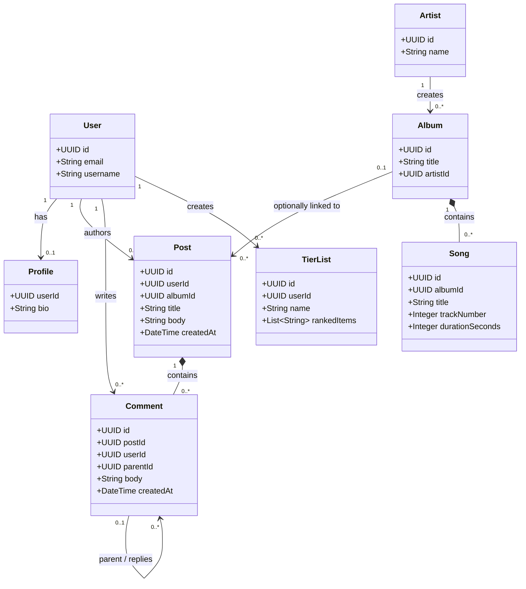

# Musicon UML Class Diagram

The diagram shows eight central domain concepts for Musicon. `User`, `Post`, and
`Comment` reflect fields and relationships used by the authentication and post
API code. `Profile`, `Album`, `TierList`, `Artist`, and `Song` represent other
features surfaced or implied by the application. The artist and song classes
are conceptual extensions; their attributes and persistence relationships
should be confirmed against the final database schema. The current profile API
is incomplete and the tier-list page is a placeholder.

